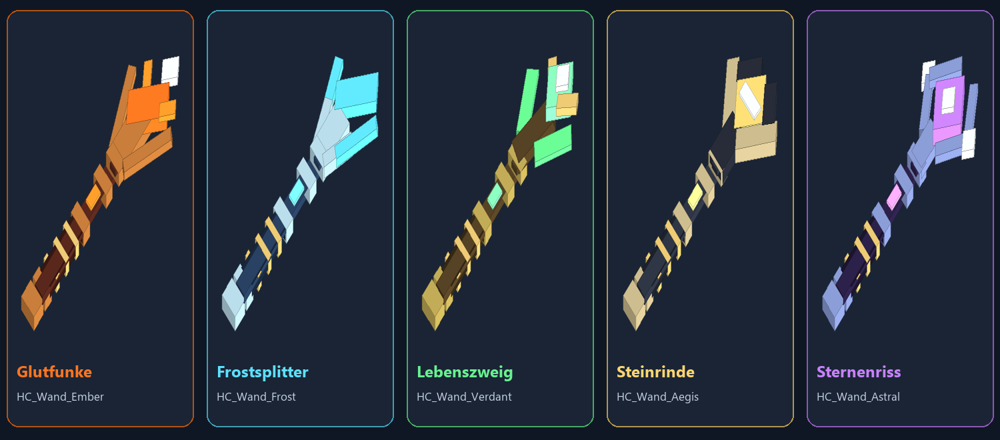

# Custom HytaleCity wands

Five custom wands are **cosmetic items** with their own models, textures, inventory icons, and German and English names. They have no spells, projectiles, effects, mana costs, or crafting recipes. The definitions are standalone and inherit no native wand behavior.



This preview was rendered from the models' geometry.

| Item ID | Name |
| --- | --- |
| `HC_Wand_Ember` | Emberwake |
| `HC_Wand_Frost` | Frostshard |
| `HC_Wand_Verdant` | Lifebloom |
| `HC_Wand_Aegis` | Stonebark |
| `HC_Wand_Astral` | Starfracture |

## Use

Install the current asset pack, restart the server, and reconnect. Use the creative inventory or these commands with the required permission:

```text
/give HC_Wand_Ember --quantity=1
/give HC_Wand_Frost --quantity=1
/give HC_Wand_Verdant --quantity=1
/give HC_Wand_Aegis --quantity=1
/give HC_Wand_Astral --quantity=1
```

## Model and texture transitions

Necks and attached runes sit slightly inside adjoining geometry to prevent visible gaps. Overlapping front and back surfaces sit at different depths to prevent Z-fighting. Texture atlases stay opaque. UV areas are inset by two pixels within their material regions, and those regions have filled edges. The native wand rig is preserved for hand animations.

The generator and validator check for coplanar front and back surfaces, unique nodes, UV bounds, and opaque textures. Verify the result in the client from several angles.

## Repository and package

The source repository is `hytale-city-assets` and the installable folder is `HytaleCity.Assets`. The manifest ID remains `HytaleCity:Assets`. The generated archive is `dist/HytaleCity.Assets.zip`, with `manifest.json` at its root.

```powershell
python HytaleCity.Assets/Development/build_wands.py --vanilla-assets "F:/Downloads/Hytale/Assets/Hytale Assets/Assets" --output dist
python HytaleCity.Assets/Development/validate_assets.py --vanilla-assets "F:/Downloads/Hytale/Assets/Hytale Assets/Assets"
```

## Consistent HC_ names

Registered custom asset IDs and resource filenames start with `HC_`. Native Hytale references, required animation nodes, folder names, and fixed framework files such as `manifest.json` and `server.lang` keep their names.

**Existing data.** The conversion renames older custom item and block IDs. Resolve old IDs in inventories, placed blocks, database rows, and configuration separately. The pack makes no automatic changes to live worlds or databases. The reference mapping is `HytaleCity.Assets/Development/asset-id-map.json` in the asset repository.

| Old ID | New ID |
| --- | --- |
| `Plot_Border_Particle` | `HC_Plot_Border_Particle` |
| `Plot_Border_Particle_Color` | `HC_Plot_Border_Particle_Color` |
| `Ingredient_Bar_Vibranium` | `HC_Ingredient_Bar_Vibranium` |
| `Portal_To_Arena` | `HC_Portal_To_Arena` |
| `Portal_To_City` | `HC_Portal_To_City` |
| `Portal_To_Farmworld` | `HC_Portal_To_Farmworld` |
| `Spawn_Portal_To_City` | `HC_Spawn_Portal_To_City` |
| `HytaleCity_Tool_Hatchet_Vibranium` | `HC_Tool_Hatchet_Vibranium` |
| `HytaleCity_Tool_Hatchet_VibraniumV2` | `HC_Tool_Hatchet_VibraniumV2` |
| `HytaleCity_Tool_Hatchet_VibraniumV3` | `HC_Tool_Hatchet_VibraniumV3` |
| `HytaleCity_Tool_Hatchet_VibraniumV4` | `HC_Tool_Hatchet_VibraniumV4` |
| `HytaleCity_Tool_Hoe_Vibranium` | `HC_Tool_Hoe_Vibranium` |
| `HytaleCity_Tool_Hoe_VibraniumV2` | `HC_Tool_Hoe_VibraniumV2` |
| `HytaleCity_Tool_Hoe_VibraniumV3` | `HC_Tool_Hoe_VibraniumV3` |
| `HytaleCity_Tool_Hoe_VibraniumV4` | `HC_Tool_Hoe_VibraniumV4` |
| `HytaleCity_Tool_Pickaxe_Vibranium` | `HC_Tool_Pickaxe_Vibranium` |
| `HytaleCity_Tool_Pickaxe_VibraniumV2` | `HC_Tool_Pickaxe_VibraniumV2` |
| `HytaleCity_Tool_Pickaxe_VibraniumV3` | `HC_Tool_Pickaxe_VibraniumV3` |
| `HytaleCity_Tool_Pickaxe_VibraniumV4` | `HC_Tool_Pickaxe_VibraniumV4` |
| `Ore_Vibranium` | `HC_Ore_Vibranium` |
| `Spawn_Portal_To_City_Hitbox` | `HC_Spawn_Portal_To_City_Hitbox` |

CityBuild must be updated together with the pack as the plot boundary particles are now called `HC_Plot_Border_Particle`.

## Verification

Static checks and the isolated native asset validator for Hytale 0.7.7 passed. Native asset warnings remain. The custom portal's obsolete `Flags.IsUsable` field was removed. Check rendering, hand positioning, and transitions in-game.

## Resource structure

Hytale stores inventory icons separately from model textures. The native `Icons/ItemsGenerated` folder is flat. Custom icons are organized under `Common/Icons/Items/`.

- `Tools/Hatchet/`, `Tools/Hoe/`, and `Tools/Pickaxe/` for tool icons.
- `Weapons/Wand/` for wand icons.
- `Resources/Ores/` for ore icons.

Models and texture atlases remain in `Common/Items/Tools/<Typ>/`, `Common/Items/Weapons/Wand/HytaleCity/`, and the custom `Common/Items/Resources/` categories. Use the same capitalization for `Pickaxe` everywhere. Item definitions under `Server/Item/Items` use paths relative to `Common`. The generator writes wand icons to the new locations. Validation checks exact path spelling even on Windows and checks the ZIP for obsolete resources.

All `HC_` item IDs remain valid with the directory change, so no additional database migration is needed. Replace the old pack during installation. Static reference and ZIP checks passed after the restructure. A new native server and client test is pending.

### Hotbar icon and shaft connection

Wands use dedicated `_Icon64.png` files without an `IconProperties` transform. Internal connector pieces close the gap at the end and connect the shaft to the head. Existing shapes and item IDs are preserved. Static checks confirm continuous shaft geometry and valid icon paths. Rendering still needs client verification.

### Native icon format and resources

Custom item icons are 64 × 64 RGBA PNGs, matching the 4,537 native generated item icons in the tested assets. Older wand icons were 128 × 128. The generator and validator enforce the native size and new `_Icon64.png` paths avoid reusing older files. Custom material and ore textures live under `Common/Items/Resources/Materials/Ingot_Textures` and `Common/Items/Resources/Ores/Ores_Texture`. References to native models under `Resources/...` remain valid. Verify rendering after replacing the pack and restarting.

### Model atlases at 128 × 128

All 19 custom model textures use 128 × 128 RGBA. The 19 item icons remain 64 × 64. Atlas expansion preserves previous pixels at their UV positions and extends edge pixels to fill the new area. It adds no texture detail and leaves model scale unchanged. The pack build runs `prepare_textures.py` and the validator enforces both formats. Live testing of the atlas expansion is pending.
