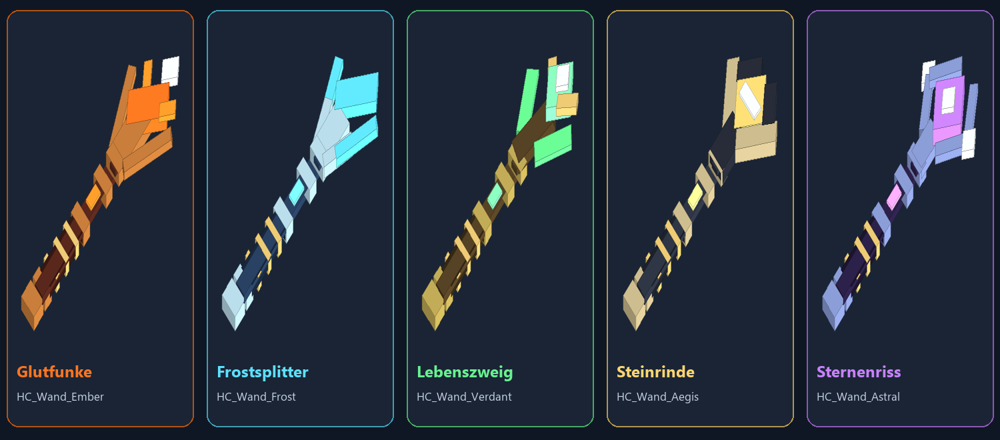

# Eigene HytaleCity-Zauberstäbe

Fünf eigene Zauberstäbe sind derzeit **rein visuelle Items**. Sie besitzen eigene Modelle, Texturen, Inventaricons und deutsche/englische Namen. Es gibt keine Zauber, Geschosse, Effekte, Mana-Kosten oder Craftingrezepte. Die Definitionen sind eigenständig und erben keine Funktionen eines nativen Zauberstabs.



Die Vorschau wurde aus der Modellgeometrie gerendert und ist kein Screenshot aus Hytale.

| Item-ID | Name |
| --- | --- |
| `HC_Wand_Ember` | Glutfunke |
| `HC_Wand_Frost` | Frostsplitter |
| `HC_Wand_Verdant` | Lebenszweig |
| `HC_Wand_Aegis` | Steinrinde |
| `HC_Wand_Astral` | Sternenriss |

## Nutzung

Nach Installation des aktuellen Assetpacks den Server neu starten und neu verbinden. Über das Kreativinventar oder mit entsprechender Berechtigung:

```text
/give HC_Wand_Ember --quantity=1
/give HC_Wand_Frost --quantity=1
/give HC_Wand_Verdant --quantity=1
/give HC_Wand_Aegis --quantity=1
/give HC_Wand_Astral --quantity=1
```

## Modell- und Texturübergänge

Die Modellhälse und aufgesetzten Runen sind leicht eingebettet, damit bündige Übergänge keine sichtbaren Spalten bilden. Überlappende Front-/Rückseiten liegen auf getrennten Tiefen gegen Z-Fighting. Die Texturatlanten bleiben vollständig deckend; UV-Flächen liegen mit zwei Pixeln Abstand im jeweiligen Materialbereich, dessen Rand aufgefüllt ist. Die native Wand-Rigstruktur bleibt für Handanimationen erhalten.

Der Generator und sein Validator prüfen die erzeugte Geometrie auf überlappende koplanare Front-/Rückflächen, eindeutige Knoten, UV-Grenzen und deckende Texturen. Das ersetzt keinen Clienttest aus verschiedenen Blickwinkeln.

## Repository und Paket

Quelle ist `hytale-city-assets`, installierbarer Ordner `HytaleCity.Assets`. Die Manifestkennung bleibt `HytaleCity:Assets`. Das erzeugte ZIP heißt `dist/HytaleCity.Assets.zip`, mit `manifest.json` direkt im ZIP-Stamm. Vorhandenes Pack ersetzen, keine zweite Kopie parallel laden.

```powershell
python HytaleCity.Assets/Development/build_wands.py --vanilla-assets "F:/Downloads/Hytale/Assets/Hytale Assets/Assets" --output dist
python HytaleCity.Assets/Development/validate_assets.py --vanilla-assets "F:/Downloads/Hytale/Assets/Hytale Assets/Assets"
```

## Einheitliche HC_-Namen

Alle eigenen registrierten Asset-IDs und Ressourcendateinamen beginnen mit `HC_`. Native Hytale-Referenzen, erforderliche Animationsknoten, Ordnernamen und feste Frameworkdateien wie `manifest.json` und `server.lang` behalten ihre Namen.

**Bestehende Daten:** Die Umstellung benennt auch ältere eigene Item-/Block-IDs um. Alte IDs in Inventaren, platzierten Blöcken, Datenbankzeilen und Configs müssen separat umgestellt werden. Es werden keine Live-Welten oder Datenbanken automatisch verändert. Die exakte Zuordnung steht im Asset-Repo unter `HytaleCity.Assets/Development/asset-id-map.json`; sie ist eine Referenz, keine automatische Hytale-Migration. Die fünf bereits mit HC_ benannten Stab-IDs bleiben gleich.

| Alte ID | Neue ID |
| --- | --- |
| `Plot_Border_Particle` | `HC_Plot_Border_Particle` |
| `Plot_Border_Particle_Color` | `HC_Plot_Border_Particle_Color` |
| `Ingredient_Bar_Vibranium` | `HC_Ingredient_Bar_Vibranium` |
| `Portal_To_Arena` | `HC_Portal_To_Arena` |
| `Portal_To_City` | `HC_Portal_To_City` |
| `Portal_To_Farmworld` | `HC_Portal_To_Farmworld` |
| `Spawn_Portal_To_City` | `HC_Spawn_Portal_To_City` |
| `HytaleCity_Tool_Hatchet_Vibranium` | `HC_Tool_Hatchet_Vibranium` |
| `HytaleCity_Tool_Hatchet_VibraniumV2` | `HC_Tool_Hatchet_VibraniumV2` |
| `HytaleCity_Tool_Hatchet_VibraniumV3` | `HC_Tool_Hatchet_VibraniumV3` |
| `HytaleCity_Tool_Hatchet_VibraniumV4` | `HC_Tool_Hatchet_VibraniumV4` |
| `HytaleCity_Tool_Hoe_Vibranium` | `HC_Tool_Hoe_Vibranium` |
| `HytaleCity_Tool_Hoe_VibraniumV2` | `HC_Tool_Hoe_VibraniumV2` |
| `HytaleCity_Tool_Hoe_VibraniumV3` | `HC_Tool_Hoe_VibraniumV3` |
| `HytaleCity_Tool_Hoe_VibraniumV4` | `HC_Tool_Hoe_VibraniumV4` |
| `HytaleCity_Tool_Pickaxe_Vibranium` | `HC_Tool_Pickaxe_Vibranium` |
| `HytaleCity_Tool_Pickaxe_VibraniumV2` | `HC_Tool_Pickaxe_VibraniumV2` |
| `HytaleCity_Tool_Pickaxe_VibraniumV3` | `HC_Tool_Pickaxe_VibraniumV3` |
| `HytaleCity_Tool_Pickaxe_VibraniumV4` | `HC_Tool_Pickaxe_VibraniumV4` |
| `Ore_Vibranium` | `HC_Ore_Vibranium` |
| `Spawn_Portal_To_City_Hitbox` | `HC_Spawn_Portal_To_City_Hitbox` |

CityBuild muss gemeinsam mit dem Pack aktualisiert werden, da die Plot-Grenzpartikel jetzt `HC_Plot_Border_Particle` heißen.

## Prüfstand

Die statischen Assetprüfungen sind erfolgreich. Der isolierte native Assetvalidator für Hytale 0.7.7 wurde erfolgreich ausgeführt; Warnungen aus dem nativen Hytale-Bestand bleiben. Ein nicht mehr ausgewertetes `Flags.IsUsable` aus dem eigenen Portal wurde ebenfalls entfernt. Darstellung, Handhaltung und Übergänge müssen weiterhin im Spiel geprüft werden.

## Ressourcenstruktur

Hytale trennt Inventaricons von Modelltexturen. Der native Ordner `Icons/ItemsGenerated` ist flach; unsere eigenen Icons liegen nach Kategorie unter `Common/Icons/Items/`:

- `Tools/Hatchet/`, `Tools/Hoe/`, `Tools/Pickaxe/` für Werkzeugicons.
- `Weapons/Wand/` für Zauberstabicons.
- `Resources/Ores/` für Erzicons.

Modelle und ihre Texturatlanten bleiben in `Common/Items/Tools/<Typ>/`, `Common/Items/Weapons/Wand/HytaleCity/` und den eigenen `Common/Items/Resources/`-Kategorien. `Pickaxe` wird überall mit derselben Großschreibung verwendet. Die Itemdefinitionen unter `Server/Item/Items` referenzieren die Pfade relativ zu `Common`; der Generator erzeugt die Zauberstabicons direkt in der neuen Struktur. Die Validierung prüft Pfadschreibweisen auch unter Windows exakt und kontrolliert, dass das ZIP keine veralteten Ressourcen enthält.

Diese Ordneränderung behält alle `HC_`-Item-IDs bei und benötigt keine zusätzliche DB-Migration. Beim Installieren das alte Pack ersetzen, statt neue Dateien darüberzukopieren. Nach der Umstrukturierung sind statische Referenz- und ZIP-Prüfungen erfolgreich; ein neuer nativer Server-/Clienttest steht noch aus.

### Hotbar-Icon und Schaftverbindung

Die Zauberstäbe verwenden eigene `_Icon64.png`-Dateien ohne `IconProperties`-Transformation. Innenliegende Verbindungsstücke schließen die Lücke am Endstück und verbinden den Schaft mit dem Kopf. Die eigenen Formen und Item-IDs bleiben erhalten. Statische Prüfungen bestätigen durchgängige Schaftgeometrie und gültige Iconpfade; die Darstellung muss noch im Client bestätigt werden.

### Natives Iconformat und Ressourcen

Alle eigenen Itemicons verwenden 64 × 64 Pixel als RGBA-PNG, entsprechend den 4.537 nativen generierten Itemicons im geprüften Hytale-Assetbestand. Die vorherigen Zauberstabicons hatten 128 × 128 Pixel. Generator und Validator erzwingen jetzt die native Größe; neue `_Icon64.png`-Pfade vermeiden die Wiederverwendung der alten Dateien. Eigene Material-/Erztexturen liegen unter `Common/Items/Resources/Materials/Ingot_Textures` beziehungsweise `Common/Items/Resources/Ores/Ores_Texture`. Referenzen auf native Modelle unter `Resources/...` bleiben erhalten. Die Ingame-Darstellung muss nach Pack-Austausch und Neustart bestätigt werden.
